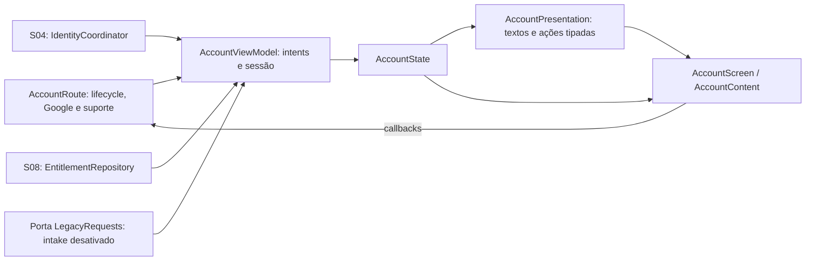

# S09 — Integração da direção V3

**Diagnósticos finais — 2026-10-15:** primeiro login suspenso corrigido após reprodução; 48 testes JVM PASS e 2 testes físicos de NavBackStackEntry/lifecycle PASS. Remoção real da entrada encerra ViewModel/adaptador e não inicia novas consultas/fotos ao retomar a Activity. Epoch na fonte e I/O já em andamento continuam limites explícitos. [Evidências e diff mínimo](S09-FIRST-LOGIN-LIFECYCLE.md). S09 PARTIAL; V3 preservada.

**Auditoria final S09 — 2026-10-15:** revisão dirigida e integração real DEV em [S09-FINAL-AUDIT.md](S09-FINAL-AUDIT.md). Pequena correção autorizada de sucesso tardio e `flatMapLatest` (switchMap do Flow); 44 testes JVM PASS, sem redesign. S09 permanece PARTIAL; nenhuma S10 iniciada. Esta nota prevalece sobre os estados históricos abaixo.

2026-10-15, branch `growth`. A direção V3 ajustada foi aprovada como referência de integração pelo proprietário. Não é fechamento operacional da S09 nem aprovação de release.

## Auditoria arquitetural curta, anterior à integração

- `AccountRoute` já cria o cliente Google S04 e o adaptador S08 somente na entrada voluntária. Coleção lifecycle-aware, suporte e fábrica ViewModel locais já existem; não precisam de uma arquitetura nova.
- `AccountViewModel` já observa identidade/direitos, serializa intents e protege o protocolo de outra identidade. Requer testes de resultados atrasados e invalidação de feedback/contexto visual na troca de titular.
- `AccountPresentation` já classifica os direitos sem concedê-los. Deve manter a classificação, trocar a linguagem de ausência de grant por informação neutra e fornecer ações de Conta declarativas/tipadas.
- `AccountScreen` concentra composição e navegação local entre três páginas. Substituir somente Conta/Meu acesso pela V3, preservar protocolo/revisão/suporte, máscaras de privacidade, confirmação de logout, botão Google e integração por callbacks. Legado confirmado oferece detalhes, nunca nova solicitação.
- O protótipo `S09AccountConceptDeviceTest` contém várias alternativas e fixtures estáticas. Não pode virar produção; os renders anteriores ficam como histórico. A validação corrente deverá renderizar a mesma `AccountScreen` funcional, sem uma segunda implementação V3.
- O plano completo de arquitetura extensível foi fornecido pelo proprietário durante a execução e incorporado a esta auditoria. Mantêm-se as fronteiras existentes e o menor conjunto de alterações; não há arquitetura paralela.

## Menor conjunto de mudanças

1. Modelo tipado de ações em S09 e despacho único na UI; enum de intenções, lista ordenada e grupos visuais, sem registro dinâmico/framework.
2. Composição V3 em componentes S09 com responsabilidades visuais reais; ponto de composição para ações de login, mantendo Google como única implementação. Sem novo provedor, Manager, Coordinator, módulo ou container DI.
3. Estado local de navegação/expansão vinculado a uma geração da sessão, sem UID/token salvo em navegação. Verificar e corrigir apenas feedback S09 de operações de titular anterior, se necessário.
4. Testes JVM de apresentação/ações/concorrência separados da instrumentação de UI, render e navegação. Validar Samsung DEV e fonte 1,5×; TalkBack somente se efetivamente disponível.

Auth, identidade S04, entitlement/cache S07/S08, contratos, Core, pipelines e backend ficam fora das alterações. OQ-07 e operação S06 continuam pendentes; S09 deve permanecer PARTIAL.

## Responsabilidades e extensões

- **Adicionar/remover/reordenar menu:** enum `AccountActionId` e lista `accountActions` em `AccountPresentation.kt`; o renderer associa ícone/semântica e `AccountScreen` despacha a intenção. Remover/reordenar uma entrada é mudança na lista. Destinos novos exigem seu callback/navegação explícitos. Renderizar um item não concede autorização: o ViewModel e os serviços continuam validando a operação.
- **Exemplo futuro, não implementado:** preferências pessoais seriam uma entrada tipada e destino próprio; não exigiriam alteração de Auth, entitlement ou suporte. Não há registry, JSON remoto, reflection ou plugin engine.
- **Provedor futuro, não implementado:** a sessão já distingue UID, providers, perfil e direitos. `AccountState.linkedProviders` permite rótulo neutro quando não for Google. O slot de composição de login mantém o botão Google como default e único mecanismo conectado. Adicionar um provedor real exige implementação autorizada na fronteira de identidade S04 e wiring no Route, com testes de linking/colisão; não basta desenhar outro botão. Não foi criada uma interface especulativa de provedores.
- **UI que muda:** lista/ícone/dispatcher para nova tarefa; entrada de login e composição do Route se um provedor for aprovado. **Intactos:** cache, projector, Core, navegação global, contratos e integrações independentes.
- **Regras de autenticação:** S04. **Regras de direitos:** backend/S07 e avaliação S08. Composables apenas apresentam o estado já avaliado; não calculam expiração, elegibilidade ou grants.
- **Estado:** um StateFlow do ViewModel; geração de sessão invalida navegação, expansão e confirmação de logout. Feedback/protocolos tardios são descartados por titular e geração, inclusive A→B→A. Nenhum UID ou token entra em SavedStateHandle/argumento de navegação.
- **Complexidade:** um arquivo de composição com componentes de responsabilidade visual, uma lista tipada e guards de sessão no ViewModel existente. O teste de conceitos passa a renderizar `AccountScreen`; implementações A/B/V3 anteriores ficam arquivadas em `.tmp/s09-integration/before/`, sem dependência de produção.

## Limites preservados

Sem mudança em S04, S08, backend ou design system global nesta integração. O botão/asset/fonte Google existentes continuam iguais. Avatar usa foto efetivamente fornecida pela sessão ou fallback, sem inventar imagem pessoal.

Não há nova chamada por oferta, observer global ou dependência de conta no Core. O I/O de conta/foto continua limitado à interface voluntária. **Ausência absoluta de sobreposição temporal com uma oferta em processamento não está comprovada:** o produtor confiável de término/drain segue pendente na S08/OQ-10. Não se usa toggle/IDLE/ON_RESUME como prova e não se modifica o pipeline para fabricar essa garantia. Isso permanece uma limitação de integração/rollout; nenhum gate comercial é ativado.

S06 operacional (operador autorizado, intake e recuperação real) e OQ-07 continuam pendentes. Fixtures visuais não são grants remotos, login real nem aprovação comercial.

## Validação desta integração

- **JVM: 43/43 PASS**: apresentação S09 (11), ViewModel S09 (20), IdentityCoordinator S04 (10), erro Firebase S04 (2). Incluem login voluntário, cancelamento, logout, cache/protocolo/foto por titular, 401/503/offline, aprovação sem grant e quatro novos casos de respostas atrasadas (incluindo A→B→A).
- **Samsung: 34 casos distintos PASS**, zero falhas/erros/skips. Primeira execução: 31 casos/51,805 s (15 fluxo/navegação/erros/fonte ampliada, 4 avatar sintético, 12 renders). Após vincular também scroll/snackbar à geração da sessão: 15/15 PASS/24,415 s (12 recapturas + 3 casos novos de fechamento do diálogo, remoção de protocolo/navegação de outro titular e detalhes sem nova recuperação). São 46 execuções físicas, não 46 casos distintos. Os testes do avatar verificam fallback, falha, logout e mesma URL com outro titular; não comprovam download de foto Google real.
- Comandos Gradle dirigidos: `:app:testIdentityDevUnitTest --tests=br.com.calcmot.account.* --tests=br.com.calcmot.identity.*`; `:app:connectedIdentityDevAndroidTest` com filtro das classes de conta. `calcmot.identityDevInstrumentation=true` e URL DEV explicitamente fornecidos; nenhum default de produção alterado. Ambos os builds concluíram com sucesso. Houve uma tentativa inicial com opção `--tests` aplicada à tarefa instrumentada; corrigida antes da execução, sem falha de teste.
- **12 capturas reais Compose** do Samsung SM-A075M/Android15/API35/720×1600: desconectado, conectado, consulta indisponível, permanente confirmado, ainda não verificado, resposta sem grant; normal e fonte 1,5×. Fixtures explicitamente identificadas, sem escrita em Firebase/D1. [Galeria local](../../.tmp/screens/s09-integrated/GALERIA.md), comparações com V3 e manifesto SHA-256 no mesmo diretório. Fonte ampliada também testada em viewport compacto 320×640dp na suíte de fluxo. Imagens fora do Git.
- **Inspeção visual:** as 12 capturas finais foram abertas e comparadas com V3. Composição, tema, logo, perfil compacto e hierarquia preservados; sem clipping/sobreposição observados. Fonte ampliada faz reflow/scroll. Verde reservado ao direito permanente confirmado; consulta indisponível não muda autenticação nem vira resposta sem grant. Sem recuperação principal em Conta e sem convite a nova solicitação para legado confirmado.
- **DEV real:** APK reinstalado apenas em `br.com.calcmot.identitydev` após a instrumentação. Entrada S09 voluntária, Google nativo aberto e cancelado: mensagem “Login cancelado”, Core não condicionado a login. Suporte acionado por teclado abriu `com.google.android.gm/.ComposeActivityGmailExternal`; nada enviado. Não se repetiram login completo, colisão real, reinstalação de produção ou fluxo de grant remoto. Os estados conectados/permanentes desta rodada são fixtures; não são novas evidências Firebase→Worker.
- **TalkBack:** estava habilitado na leitura inicial desta validação manual. Após uso do controlador mobile, ficou sem binding. Encerrado somente o processo auxiliar identificado `com.mobilenext.mobilecli.DeviceServer`, liberando o binding Samsung; reativado exclusivamente TalkBack, preservando demais serviços. `dumpsys accessibility` confirmou serviço vinculado, exploração por toque e feedback falado habilitados. Capturas `talkback-keyboard-2.png`/`3.png` mostram foco no Google e na continuação; suporte acionável por teclado. **Áudio e percurso completo por gestos não auditados**; tentativas por swipe injetado não comprovaram avanço de leitura. Não equivalem a validação completa com usuário TalkBack. Na leitura final, TalkBack estava OFF e diferente da leitura inicial ON; não se atribui autoria a essa mudança sem evidência e não se reativa novamente. Houve prova de binding/foco durante o ensaio, não de leitura completa. Nenhuma permissão do CalcMot foi alterada.
- **Preservação:** hashes SHA-256 de 207 arquivos protegidos iguais ao início, incluindo código fora de S09, contratos, backend e Gradle. `AccountRoute`, `GoogleAccountAvatar` e `LegacyClaimContract` também iguais às cópias iniciais. Sem deploy/push/release, concessão, compra ou ativação de gates.

XMLs e resumos: `.tmp/s09-integration/first-results/`, `final-device.xml`, `results.json`, `talkback-result.json`. As suítes gerais e testes anteriores sem mudança relevante não foram repetidos.

## Arquivos desta integração

Produção S09: novo `AccountContent.kt`; alterados `AccountScreen.kt`, `AccountPresentation.kt`, `AccountViewModel.kt`. Nenhuma cópia integral do protótipo em produção.

Testes: `AccountPresentationTest.kt`, `AccountViewModelTest.kt`, `AccountScreenDeviceTest.kt`, `S09AccountConceptDeviceTest.kt` (harness da UI real), novo `AccountSessionDeviceTest.kt`. `GoogleAccountAvatarDeviceTest` existente foi executado sem modificação.

Documentação: este relatório, `S09-IDENTITY-RECOVERY-UI.md`, `S09-ACCOUNT-CONCEPTS.md`, BACKLOG e EXECUTION-PLAN.

**Status S09: PARTIAL.** Integração visual aprovada executada e validada localmente; operação S06/OQ-07, intake/recuperação reais, validação completa TalkBack e garantia de ausência de I/O concorrente ao runtime continuam pendentes. Backend de produção HOLD; nenhuma próxima story iniciada.

